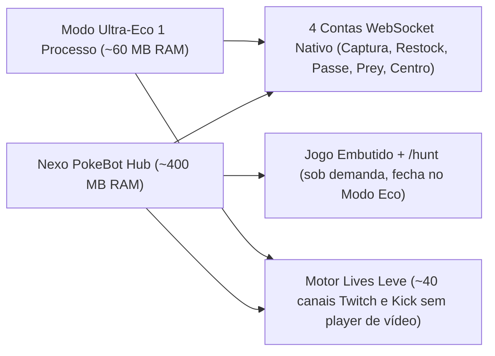

<p align="center">
  
</p>

<h1 align="center">Nexo PokeBot</h1>

<p align="center">
  <strong>Hub multi-contas e motor Headless Eco desenvolvidos especificamente para o <a href="https://pokeidle.io/app">PokeIdle</a> (Poke Idle World).</strong><br />
  4 contas isoladas + ~40 lives simultâneas (Twitch e Kick) consumindo em média <strong>~400 MB de RAM</strong> (ou <strong>~60 MB</strong> no Modo Ultra-Eco).
</p>

<p align="center">
  <a href="https://github.com/felipegakkeku/nexo-pokebot/releases/latest"></a>
  <a href="LICENSE"></a>
  
  
  
  
  <a href="#apoiar-o-projeto"></a>
</p>

<p align="center">
  <a href="#instalação-e-execução">Download Windows</a> ·
  <a href="#performance-e-consumo-de-ram">Performance</a> ·
  <a href="#o-que-o-nexo-pokebot-entrega-pronto-para-uso">Funcionalidades</a> ·
  <a href="#migrar-ou-recuperar-contas-em-1-clique">Migrar em 1 Clique</a> ·
  <a href="#arquitetura-do-projeto">Arquitetura</a> ·
  <a href="#apoiar-o-projeto">Apoiar</a>
</p>

---

Cliente desktop open source (licença MIT) para o **[PokeIdle (`pokeidle.io`)](https://pokeidle.io/app)**: une até **4 contas isoladas em uma única janela**, motor WebSocket de baixo consumo, acompanhamento leve de dezenas de lives na Twitch e Kick, extensão `/hunt for PokeIdle` nativa, Centro Médico integrado à troca de hunt, importador 1-clique de contas de outros decks e telemetria completa em tema escuro. Tudo 100% local, sem anúncios, sem telemetria externa e sem exigir depuração remota no seu navegador.

## Performance e consumo de RAM

Apps multi-contas tradicionais mantêm vários processos de navegador/WebView2 e players de vídeo abertos ao mesmo tempo, disparando o uso de RAM e GPU para **2 GB ou mais**. O **Nexo PokeBot** substitui abas pesadas por protocolo direto:

- **Farm das 4 contas via WebSocket nativo**: captura em caídos, restock, passe diário, prey, troca de hunt e Centro Médico rodam sem renderizar o DOM do jogo em segundo plano.
- **~40 lives simultâneas sem player de vídeo**: o acompanhamento na Twitch (`minute-watched` / HLS `HEAD` / GQL) e na Kick (WebSocket de espectador + REST) acumula pontos e gerencia bônus sem decodificar vídeo nem abrir dezenas de abas.
- **Jogo embutido sob demanda**: abra o jogo na tela apenas quando quiser jogar manualmente ou usar o `/hunt`, e volte ao **Modo Eco** com 1 clique para derrubar o uso de memória na hora.

| Cenário | Consumo médio de RAM | Economia vs. apps comuns | Carga de CPU / GPU | Como funciona |
| --- | --- | --- | --- | --- |
| **Apps similares (WebView2 / múltiplas abas)** | **~2 GB+ de RAM** | Baseline | Alta (DOM + decodificação de vídeo) | 4 janelas do jogo + dezenas de abas de stream abertas |
| **Nexo PokeBot Hub (4 contas + ~40 lives)** | **~400 MB de RAM** | **~5x menos RAM** | Muito baixa | Hub desktop + motor WebSocket + lives por protocolo leve |
| **Nexo PokeBot Modo Ultra-Eco (1 Processo)** | **~60 MB de RAM total** | **~33x menos RAM** | Mínima (zero Chromium/GPU) | 1 processo Node puro rodando as 4 contas e lives em 2º plano |



## O que o Nexo PokeBot entrega pronto para uso

1. **4 contas isoladas em 1 janela (`persist:conta1..4`)**: alterne entre **Painel + Jogo**, **Grade 2x2** (todas as contas juntas na mesma tela) e **Só Painel (Eco)** sem abrir várias instâncias de navegador.
2. **Motor Headless Eco + ~40 lives em ~400 MB de RAM**: mantém até 4 contas farmando via WebSocket nativo e dezenas de lives simultâneas ativas (captura inteligente em caídos, restock de bolas/poções/revives, passe diário, prey e reconexão/`--standby` automática no código `4001`) com uma fração da memória de apps convencionais.
3. **Integração nativa com `/hunt for PokeIdle`**: carrega a extensão oficial `/hunt` diretamente dentro da tela embutida do jogo e também calcula recomendações (XP/h, ouro/h e shiny/h) em Worker thread no modo Headless Eco sem travar a interface.
4. **Centro Médico integrado à troca de hunt**: acompanha a mesma contagem de saída de combate do servidor (`centroLivreEm` / `trocaHuntLivreEm`), habilitando o clique no **Centro Médico** assim que libera e permitindo **agendar a troca de hunt** mesmo tomando dano (a troca dispara automaticamente no instante em que o combate zera).
5. **Lives da Twitch e Kick respeitando o navegador e perfil configurados**: lista todos os perfis instalados (Chrome, Brave e Edge) e identifica automaticamente o motor de perfis isolados para abrir lives e chat sempre na mesma conta logada, com buff configurável por canal e gestor inteligente de bônus.
6. **Telemetria de eficiência, drops filtráveis e notificações toast**: identifica foco do mapa (Outland, Unova, Boss ou Hunt), contabiliza drops com filtros clicáveis por categoria/item, calcula tempo/abate, capturas/abate e lucro líquido/h, e exibe toasts flutuantes para shinies, drops raros, recompensas e alertas.
7. **Importador e recuperador de sessões em 1 clique (`Recuperar Sessoes Nexo PokeBot.bat`)**: importa diretamente as 4 contas (**PokeIdle + Twitch + Kick**) já logadas de **PokeIdleMulti**, **IdleDeck**, **PokeGrid**, pastas antigas do PokeBot ou até da Lixeira do Windows, sem precisar instalar Node.js.
8. **Atualização automática via GitHub Releases no app e no `.exe`**: verifica novas Releases automaticamente ao abrir (ou por `Nexo PokeBot.exe --update`), baixa e aplica o pacote reiniciando o app sem apagar suas 4 contas, sessões ou configurações (`.pokebot-*`).
9. **Monitor de Vote & Ganhe (IdleHub.io) em 1 clique**: consulta `/idlehub/me` nas 4 contas, dispara toast quando o voto diário liberar ou creditar diamantes e abre o link oficial já com o nick preenchido no perfil configurado de cada conta.
10. **Identidade nativa no Windows**: executável, runtime Electron (`Nexo PokeBot.exe`), bandeja única por nick e ícone multi-resolução (16 a 256 px) identificados corretamente no Gerenciador de Tarefas e na Barra de Tarefas.

## Modos de execução

| Modo | Como abrir | Consumo típico | Indicado para |
| --- | --- | --- | --- |
| **Nexo PokeBot Hub (Recomendado)** | `Nexo PokeBot.exe` ou `Abrir Nexo PokeBot.bat` | ~400 MB RAM em média (4 contas + ~40 lives) | Gerenciar até 4 contas com jogo embutido, `/hunt`, grade 2x2 e lives simultâneas |
| **Modo Ultra-Eco (1 Processo)** | `Abrir Nexo PokeBot Eco (1 Processo).bat` ou `Nexo PokeBot.exe --eco` | ~60 MB RAM total (zero Chromium/GPU) | Farmar 24/7 em segundo plano acessando os painéis em `127.0.0.1:17890..17893` |
| **Headless CLI** | `npm run headless` | ~35 MB RAM | Sessão única direto no terminal |

## Instalação e execução

### Opção 1: Pacote pronto para Windows (sem instalar Node.js)

1. Baixe **`Nexo-PokeBot-v1.0.10.zip`** na página de [Releases](https://github.com/felipegakkeku/nexo-pokebot/releases/latest).
2. **Extraia todo o conteúdo** do ZIP para uma pasta local (ex.: `C:\Nexo-PokeBot`). Não abra o `.exe` direto de dentro do ZIP.
3. Abra **`Nexo PokeBot.exe`**.
4. Na primeira vez, clique em **Abrir jogo embutido** (ou na aba **Conexões**) para entrar em cada uma das suas contas (Contas 1 a 4), ou use o importador automático abaixo se já estiver logado em outro app. Depois de logado, use **Modo Eco** para farmar em segundo plano.
5. *(Opcional)* Para o `/hunt` aparecer na tela embutida e calcular rankings no Modo Eco, mantenha a extensão **`/hunt for PokeIdle`** instalada no Google Chrome (ou Edge/Brave).

### Migrar ou recuperar contas em 1 clique

Já usa outro multi-contas ou atualizou a pasta do PokeBot? Execute **`Recuperar Sessoes Nexo PokeBot.bat`** (incluído no repositório e dentro do ZIP):

- **Importação direta de outros apps (PokeIdle + Twitch + Kick)**: detecta e extrai automaticamente as sessões das 4 contas do **[PokeIdleMulti](https://github.com/artbruno35/PokeIdleMulti)** (`%LOCALAPPDATA%\PokeIdleMulti`), **IdleDeck** (`MacedoTI.IdleDeck_*`) e **PokeGrid** (`%APPDATA%\PokeGrid`), incluindo os logins de **Twitch** (`auth-token` / `unique_id`) e **Kick** (`session_token`) descriptografados localmente via DPAPI do próprio usuário Windows.
- **Recuperação de pastas antigas e Lixeira**: procura instalações anteriores do PokeBot no disco (Desktop, Downloads, Documentos, OneDrive, `C:\`, `D:\`) e na Lixeira do Windows (`$Recycle.Bin`), restaurando sessões, perfis e tokens de lives com backup automático.
- **Zero dependências externas**: usa o motor embutido no próprio `Nexo PokeBot.exe` (`ELECTRON_RUN_AS_NODE=1` + `node:sqlite`), funcionando mesmo em PCs sem Node.js instalado.

### Opção 2: Executar a partir do código-fonte

Pré-requisito: **Node.js 24 LTS** no Windows.

1. Dê dois cliques em **`Abrir Nexo PokeBot.bat`** (instala dependências, aplica o branding do runtime e abre o Hub), ou execute no PowerShell:
   ```powershell
   npm.cmd ci
   npm.cmd run hub
   ```
2. Para rodar as 4 contas no **Modo Ultra-Eco (1 processo Node)**:
   ```powershell
   npm.cmd run eco
   ```

Todas as sessões, cookies e configurações ficam salvos localmente em arquivos `.pokebot-*` na pasta do app (ignorados pelo Git e bloqueados automaticamente no empacotamento do ZIP).

## Arquitetura do projeto

- `src/electron/`: shell desktop Electron (`main.mjs`, `renderer.html`, `renderer.js`, `styles.css`, `preload.cjs`, `webview-preload.cjs`) com 4 partições isoladas, bandeja única, toasts e integração `/hunt`.
- `src/headless/`: motor WebSocket nativo (`protocol-engine.mjs`, `cli-runner.mjs`), controlador HTTP/API e lives (`gui-server.mjs`, `gui-dashboard.html`), daemon multi-conta (`multi-daemon.mjs`), extrator de sessão (`session-extractor.mjs`) e Worker `/hunt` (`hunt-guide.mjs`, `hunt-guide-worker.mjs`).
- `src/desktop/`: launcher Windows (`PokeBotApp.cs`, `build-exe.mjs`), patch de ícone/metadados PE do runtime Electron (`brand-runtime.mjs`, `launch-hub.mjs`) e gerador do ZIP limpo (`build-friend-zip.mjs`).
- `src/modules/`: módulos de regras de automação compartilhados (`live-rewards.js`, `capture.js`, `restock.js`, `boss-loot.js`, `prey.js`, `daily-pass.js`, entre outros).
- `assets/` e `docs/`: ícone original multi-resolução (`nexo-pokebot-icon.png`, `nexo-pokebot.ico`) e QR Code Pix offline (`docs/pix-qr.png`).
- `tests/`: suíte automatizada com `node:test` + `jsdom` (259 testes cobrindo protocolo, lives, perfis, Centro Médico, `/hunt` e build desktop).

## Referências e ecossistema PokeIdle

O **Nexo PokeBot** foi construído especificamente para a comunidade do **[PokeIdle (`pokeidle.io`)](https://pokeidle.io/app)** e referencia projetos abertos que inspiraram ou complementam o ecossistema do jogo:

- **[PokeGrid (`soufoka/PokeGrid`)](https://github.com/soufoka/PokeGrid)** e **[PokeGrid-source (`soufoka/PokeGrid-source`)](https://github.com/soufoka/PokeGrid-source)**: referência da comunidade para rodar até 4 contas isoladas de Poke Idle World em uma única janela em grade.
- **[pokeidleDeck (`darlanhms/pokeidleDeck`)](https://github.com/darlanhms/pokeidleDeck)**: deck desktop multi-contas para PokeIdle com coleta de recompensas de lives e recompra de itens.
- **[PokeIdleMulti (`artbruno35/PokeIdleMulti`)](https://github.com/artbruno35/PokeIdleMulti)**: cliente multi-contas em WebView2 para PokeIdle, com importação direta de sessões (PokeIdle + Twitch + Kick) suportada pelo `Recuperar Sessoes Nexo PokeBot.bat`.
- **[PokéIdle Hub e extensão `/hunt for PokeIdle`](https://pokeidleguide.io/#hunt)**: guia de hunts e extensão oficial da comunidade para ranking de XP/h, ouro/h e shiny/h integrada pelo Nexo PokeBot no embutido e no Modo Eco.

> **Palavras-chave:** `pokeidle` · `poke-idle-world` · `pokeidle.io` · `nexo-pokebot` · `pokebot` · `pokegrid` · `pokeidle-deck` · `pokeidle-multi` · `hunt-for-pokeidle` · `multi-account` · `electron` · `websocket` · `windows`

## Desenvolvimento e empacotamento

```powershell
npm.cmd ci                  # instala dependências exatas do package-lock.json
npm.cmd run check           # ESLint + build + 259 testes automatizados
npm.cmd run brand:runtime   # aplica ícone e metadados PE no runtime Electron local
npm.cmd run build:exe       # compila Nexo PokeBot.exe via csc.exe
npm.cmd run package:friend  # gera release/Nexo-PokeBot-v1.0.zip limpo (sem dados pessoais)
```

O workflow [`.github/workflows/release.yml`](.github/workflows/release.yml) roda `npm ci`, `npm run check`, valida a tag `vX.Y.Z` contra o `package.json`, empacota `Nexo-PokeBot-vX.Y.zip` no Windows e publica a Release automaticamente ao enviar uma tag.

## Apoiar o projeto

O Nexo PokeBot é 100% gratuito, open source (MIT), sem anúncios e sem telemetria. Se o projeto ajudou no seu farm e você quiser apoiar o desenvolvimento contínuo:


- **Chave Pix (Aleatória)**:
  ```text
  0a2a3538-4d9e-4eeb-836e-5ee6136ab7ff
  ```
- **Pix Copia e Cola (valor livre)**:
  ```text
  00020126580014br.gov.bcb.pix01360a2a3538-4d9e-4eeb-836e-5ee6136ab7ff5204000053039865802BR5912NEXO TORRENT6006BRASIL62070503***63040F5D
  ```
- **Ou se preferir envie gold para `"gake"` no jogo kkkkkkk**

O app do seu banco identifica o recebedor automaticamente pela chave aleatória. Você também encontra esse QR Code offline dentro do próprio aplicativo clicando em **Apoiar ♥** na barra superior. Outras formas de apoiar: deixar uma estrela no repositório, reportar bugs ou sugerir melhorias nas Issues.

## Licença

Distribuído sob a licença MIT. Consulte [LICENSE](LICENSE) para detalhes.
