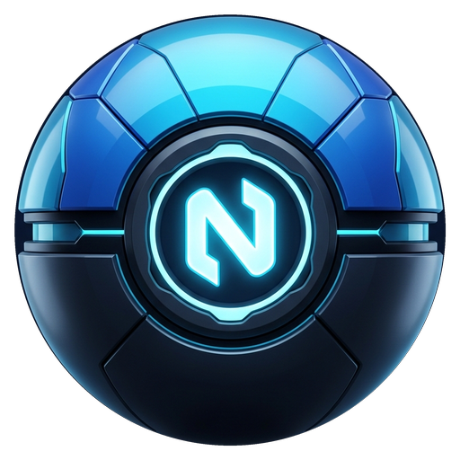

<p align="center">
  
</p>

# Nexo PokeBot

<p>
  <a href="https://github.com/felipegakkeku/nexo-pokebot/releases/latest"></a>
  
  
  
  <a href="#apoiar-o-projeto"></a>
</p>

Hub desktop multi-contas e motor Headless Eco desenvolvidos **especificamente para o [PokeIdle](https://pokeidle.io/app) (Poke Idle World)**: roda até **4 contas isoladas em uma única janela**, alterna para farm WebSocket de baixo consumo (~60 MB RAM), integra `/hunt for PokeIdle`, Centro Médico, recompensas de lives (Twitch e Kick) e telemetria em tema escuro, tudo 100% local, sem anúncios, sem telemetria externa e sem exigir depuração remota no seu navegador.

## O que o Nexo PokeBot entrega pronto para uso

1. **4 contas isoladas em 1 janela (`persist:conta1..4`)**: alterne entre **Painel + Jogo**, **Grade 2x2** (todas as contas juntas na mesma tela) e **Só Painel (Eco)** sem abrir várias instâncias de navegador.
2. **Modo Ultra-Eco Headless via WebSocket nativo**: fecha os navegadores embutidos mantendo todas as contas farmando em segundo plano com captura inteligente em caídos, restock de bolas/poções/revives, passe diário, prey e reconexão/`--standby` automática no código `4001`.
3. **Integração nativa com `/hunt for PokeIdle`**: carrega a extensão oficial `/hunt` diretamente dentro da tela embutida do jogo e também calcula recomendações (XP/h, ouro/h e shiny/h) em Worker thread no modo Headless Eco sem travar a interface.
4. **Centro Médico integrado à troca de hunt**: acompanha a mesma contagem de saída de combate do servidor (`centroLivreEm` / `trocaHuntLivreEm`), habilitando o clique no **Centro Médico** assim que libera e permitindo **agendar a troca de hunt** mesmo tomando dano (a troca dispara automaticamente no instante em que o combate zera).
5. **Lives da Twitch e Kick respeitando o navegador e perfil configurados**: lista todos os perfis instalados (Chrome, Brave e Edge) e identifica automaticamente o motor de perfis isolados para abrir lives e chat sempre na mesma conta logada, com buff configurável por canal e gestor inteligente de bônus.
6. **Telemetria de eficiência, drops filtráveis e notificações toast**: identifica foco do mapa (Outland, Unova, Boss ou Hunt), contabiliza drops com filtros clicáveis por categoria/item, calcula tempo/abate, capturas/abate e lucro líquido/h, e exibe toasts flutuantes para shinies, drops raros, recompensas e alertas.
7. **Identidade nativa no Windows**: executável, runtime Electron (`Nexo PokeBot.exe`), bandeja única por nick e ícone multi-resolução (16 a 256 px) identificados corretamente no Gerenciador de Tarefas e na Barra de Tarefas.

## Modos de execução

| Modo | Como abrir | Consumo típico | Indicado para |
| --- | --- | --- | --- |
| **Nexo PokeBot Hub (Recomendado)** | `Nexo PokeBot.exe` ou `Abrir Nexo PokeBot.bat` | Médio (baixo no Modo Eco) | Gerenciar até 4 contas com jogo embutido, `/hunt`, grade 2x2 e bandeja única |
| **Modo Ultra-Eco (1 Processo)** | `Abrir Nexo PokeBot Eco (1 Processo).bat` ou `Nexo PokeBot.exe --eco` | ~60 MB RAM total (zero Chromium/GPU) | Farmar 24/7 em segundo plano acessando os painéis em `127.0.0.1:17890..17893` |
| **Headless CLI** | `npm run headless` | ~35 MB RAM | Sessão única direto no terminal |

## Instalação e execução

### Opção 1: Pacote pronto para Windows (sem instalar Node.js)

1. Baixe **`Nexo-PokeBot-v1.0.zip`** na página de [Releases](https://github.com/felipegakkeku/nexo-pokebot/releases/latest).
2. **Extraia todo o conteúdo** do ZIP para uma pasta local (ex.: `C:\Nexo-PokeBot`). Não abra o `.exe` direto de dentro do ZIP.
3. Abra **`Nexo PokeBot.exe`**.
4. Na primeira vez, clique em **Abrir jogo embutido** (ou na aba **Conexões**) para entrar em cada uma das suas contas (Contas 1 a 4). Depois de logado, use **Modo Eco** para farmar em segundo plano.
5. *(Opcional)* Para o `/hunt` aparecer na tela embutida e calcular rankings no Modo Eco, mantenha a extensão **`/hunt for PokeIdle`** instalada no Google Chrome (ou Edge/Brave).

### Opção 2: Executar a partir do código-fonte

Pré-requisito: **Node.js 24 LTS** no Windows.

1. Dê dois cliques em **`Abrir Nexo PokeBot.bat`** (instala dependências, aplica o branding do runtime e abre o Hub), ou execute no PowerShell:
   ```powershell
   npm.cmd ci
   npm.cmd run hub
   ```
2. Para rodar as 4 contas no **Modo Ultra-Eco (1 processo Node)**:
   ```powershell
   npm.cmd run eco
   ```

Todas as sessões, cookies e configurações ficam salvos localmente em arquivos `.pokebot-*` na pasta do app (ignorados pelo Git e bloqueados automaticamente no empacotamento do ZIP).

## Arquitetura do projeto

- `src/electron/`: shell desktop Electron (`main.mjs`, `renderer.html`, `renderer.js`, `styles.css`, `preload.cjs`, `webview-preload.cjs`) com 4 partições isoladas, bandeja única, toasts e integração `/hunt`.
- `src/headless/`: motor WebSocket nativo (`protocol-engine.mjs`, `cli-runner.mjs`), controlador HTTP/API e lives (`gui-server.mjs`, `gui-dashboard.html`), daemon multi-conta (`multi-daemon.mjs`), extrator de sessão (`session-extractor.mjs`) e Worker `/hunt` (`hunt-guide.mjs`, `hunt-guide-worker.mjs`).
- `src/desktop/`: launcher Windows (`PokeBotApp.cs`, `build-exe.mjs`), patch de ícone/metadados PE do runtime Electron (`brand-runtime.mjs`, `launch-hub.mjs`) e gerador do ZIP limpo (`build-friend-zip.mjs`).
- `src/modules/`: módulos de regras de automação compartilhados (`live-rewards.js`, `capture.js`, `restock.js`, `boss-loot.js`, `prey.js`, `daily-pass.js`, entre outros).
- `assets/`: ícone original multi-resolução (`nexo-pokebot-icon.png` e `nexo-pokebot.ico`).
- `tests/`: suíte automatizada com `node:test` + `jsdom` (259 testes cobrindo protocolo, lives, perfis, Centro Médico, `/hunt` e build desktop).

## Referências e ecossistema PokeIdle

O **Nexo PokeBot** foi construído especificamente para a comunidade do **[PokeIdle (`pokeidle.io`)](https://pokeidle.io/app)** e referencia projetos abertos que inspiraram ou complementam o ecossistema do jogo:

- **[PokeGrid (`soufoka/PokeGrid`)](https://github.com/soufoka/PokeGrid)** e **[PokeGrid-source (`soufoka/PokeGrid-source`)](https://github.com/soufoka/PokeGrid-source)**: referência da comunidade para rodar até 4 contas isoladas de Poke Idle World em uma única janela em grade.
- **[pokeidleDeck (`darlanhms/pokeidleDeck`)](https://github.com/darlanhms/pokeidleDeck)**: deck desktop multi-contas para PokeIdle com coleta de recompensas de lives e recompra de itens.
- **[PokéIdle Hub e extensão `/hunt for PokeIdle`](https://pokeidleguide.io/#hunt)**: guia de hunts e extensão oficial da comunidade para ranking de XP/h, ouro/h e shiny/h integrada pelo Nexo PokeBot no embutido e no Modo Eco.

> **Palavras-chave:** `pokeidle` · `poke-idle-world` · `pokeidle.io` · `nexo-pokebot` · `pokebot` · `pokegrid` · `pokeidle-deck` · `hunt-for-pokeidle` · `multi-account` · `electron` · `websocket` · `windows`

## Desenvolvimento e empacotamento

```powershell
npm.cmd ci                  # instala dependências exatas do package-lock.json
npm.cmd run check           # ESLint + build + 259 testes automatizados
npm.cmd run brand:runtime   # aplica ícone e metadados PE no runtime Electron local
npm.cmd run build:exe       # compila Nexo PokeBot.exe via csc.exe
npm.cmd run package:friend  # gera release/Nexo-PokeBot-v1.0.zip limpo (sem dados pessoais)
```

O workflow [`.github/workflows/release.yml`](.github/workflows/release.yml) roda `npm ci`, `npm run check`, valida a tag `vX.Y.Z` contra o `package.json`, empacota `Nexo-PokeBot-vX.Y.zip` no Windows e publica a Release automaticamente ao enviar uma tag.

## Apoiar o projeto

O Nexo PokeBot é gratuito, sem anúncios e sem telemetria. Se o projeto ajudou no seu farm e você quiser apoiar o desenvolvimento contínuo:

- **Chave Pix (Aleatória)**:
  ```text
  0a2a3538-4d9e-4eeb-836e-5ee6136ab7ff
  ```
- **Ou se preferir envie gold para `"gake"` no jogo kkkkkkk**

Você também encontra o atalho de apoio direto na barra superior do aplicativo clicando em **Apoiar ♥**.
